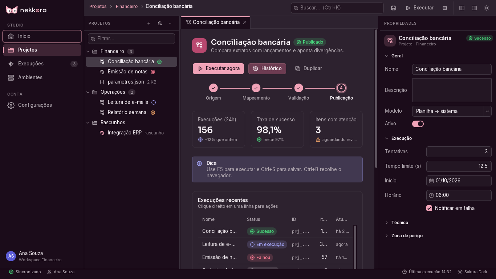
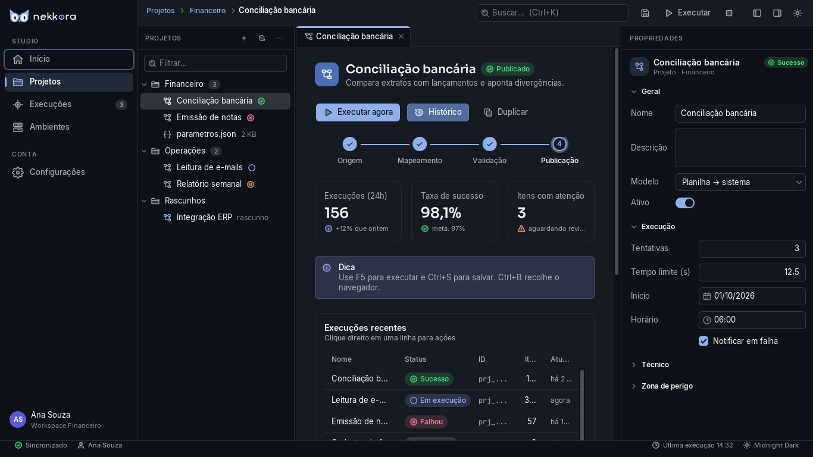
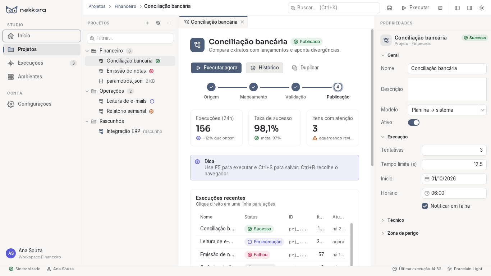
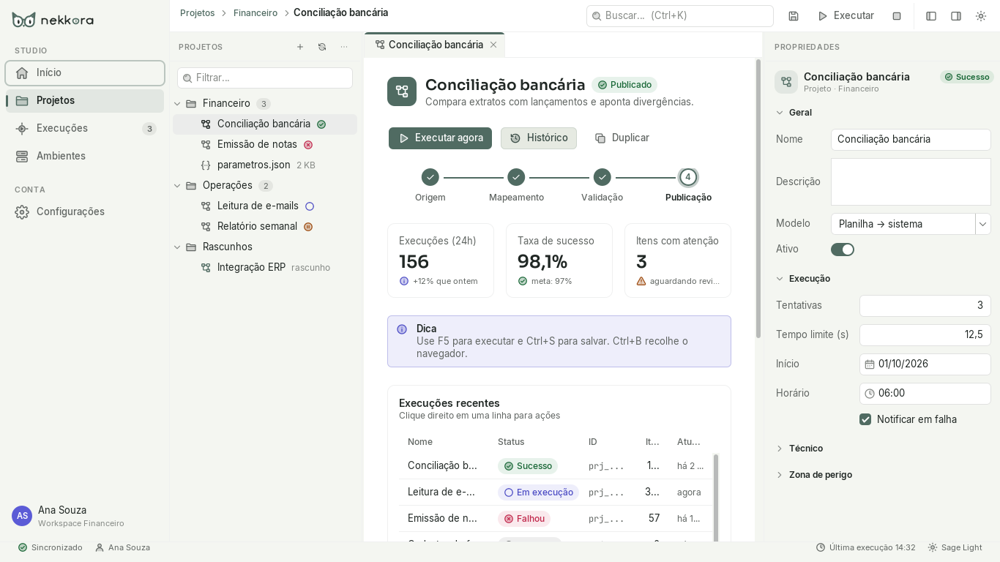

# Nekkora Studio — Nekkora Swing UI

Base visual do **Nekkora Studio** em Java Swing: um design system completo em que **nenhuma tela decide cor,
fonte, borda, espaçamento ou comportamento visual por conta própria**. As telas escolhem *intenções*
(`NekkoraButton.Variant.PRIMARY`, `Status.SUCCESS`, `TypeStyle.H2`, `Spacing.SPACE_6`) e a biblioteca decide
a aparência a partir dos tokens do tema ativo.



| Midnight Dark | Porcelain Light | Sage Light |
|---|---|---|
|  |  |  |

## Módulos

```
nekkora-design-tokens   → tokens semânticos + 4 temas (sem Swing)
nekkora-swing-ui        → tema/LaF, tipografia, ícones, marca, componentes e padrões genéricos de estúdio
nekkora-swing-showcase  → "Nekkora Design System Showcase" + tela Studio fictícia (demonstração)
nekkora-studio-domain   → modelo de automações: Automação → Sessões lógicas → Etapas (Java puro)
nekkora-studio-bridge   → Studio Bridge nekkora-bridge/1: canal local autenticado com o Native Host (Java puro)
nekkora-studio-recorder → RecorderController: gravação técnica confirmada pela extensão (Java puro)
nekkora-studio-persistence → projeto .nekkora: formato versionado, validação, reconstrução e gravação atômica (Java puro)
nekkora-studio-validation → Automation Validation Engine: diagnóstico estrutural, sem execução (Java puro)
nekkora-studio-guided   → debug guiado: plano intermediário, regra de reuso e registro do debug (Java puro)
nekkora-studio-pdd      → PDD visual: projeção somente leitura, rascunho revisável, verificação de imagens e PDF (PDFBox)
nekkora-studio-ui       → peças visuais do Studio (navegação, automação, sessões, etapas, propriedades, diálogos,
                          Floating Recorder)
nekkora-studio-app      → a aplicação Nekkora Studio (jar executável)
```

O Nekkora Studio funcional nasceu na missão STUDIO-001 — veja [docs/studio-001](docs/studio-001/architecture.md) e o
[relatório](reports/studio-001-final-report.md).

**STUDIO-002 — gravação técnica controlada pelo Studio.** Com o Chrome aberto e "Conectar ao Nekkora Studio" ligado no
painel da [Nekkora Extension](https://github.com/Nekkora-Operation/Nekkora-Extension-Chrome), o botão **Gravar** inicia
uma captura técnica real numa aba autorizada e abre o **Floating Recorder** (pausar, continuar, modo, nova sessão,
finalizar, cancelar). Finalizar **não exporta** PageMap. Veja [docs/studio-002](docs/studio-002/architecture.md) e
o [relatório](reports/studio-002-final-report.md).

**STUDIO-003 — interações reais viram etapas.** Durante a gravação, cada interação no Chrome vira uma instrução na
sessão escolhida: "Preencher campo Usuário", "Clicar no botão Entrar", "Selecionar São Paulo no campo Estado" e
assim por diante. As regras são determinísticas, sem IA. Cada etapa tem a referência técnica do elemento (localizador
validado, trajetória por iframe e Shadow DOM) e procedência "Gravada". Valores digitados **não** são guardados.

- **Capturar e interagir**: a página funciona normalmente.
- **Capturar**: registra o elemento sem executar a ação.

As etapas só contam depois que o Studio as registra. Cancelar descarta só as etapas daquela gravação. Veja
[docs/studio-003](docs/studio-003/architecture.md) e o [relatório](reports/studio-003-final-report.md).

**STUDIO-004 — editor de automações, sessões e etapas.** O processo gravado pode ser organizado e complementado sem
perder o que foi observado.

- **Editar:** automação (F2), sessão (nome, descrição, observações) e etapa, num editor com abas: Geral, Parâmetros,
  Elemento, Comentários e Origem e alterações.
- **Reorganizar:** Alt+↑/↓, "Mover para…" entre sessões, Ctrl+D duplica e Delete exclui, sempre com confirmação.
- **Parâmetros:** variável ou credencial (só o apelido) e opção com rótulo e valor técnico.
- **Localizadores:** o preferencial pode ser outro validado na captura; os propostos à mão ficam "Não verificado".
- **Ctrl+Z / Ctrl+Y** desfazem e refazem em memória.

A etapa gravada continua "Gravada", com o valor original ao lado do atual. Durante uma gravação, a automação gravada
fica protegida contra edições. Veja [docs/studio-004](docs/studio-004/architecture.md) e o
[relatório](reports/studio-004-final-report.md).

**STUDIO-006 — projetos salvos e recuperação.** Cada automação vira um projeto `.nekkora` (menu **Arquivo**: Novo
projeto, Abrir projeto… Ctrl+O, Salvar Ctrl+S, Salvar como… Ctrl+Shift+S, Projetos recentes, Fechar projeto, Sair).
Salvar, fechar e abrir de novo preserva identidades, ordem, procedência, valores capturados, edições manuais e
evidências (com o resultado de negócio "Não validado"). O desfazer/refazer continua só na sessão de edição.

- O arquivo é **local, não criptografado** e legível por ferramentas comuns: não guarde segredos nele. Credenciais
  aparecem só pelo apelido; valores digitados nas páginas nunca são gravados.
- Gravação atômica e verificada: uma falha nunca destrói o arquivo anterior. Alteração externa é detectada.
- A aba mostra `*` enquanto há alterações não salvas; durante uma gravação o salvamento espera a gravação terminar.
- **Recuperação automática** (só depois do seu consentimento, em Arquivo → Recuperação automática…): cópias locais
  das alterações não salvas, oferecidas ao abrir o Studio depois de um encerramento inesperado. Pasta própria
  (`NEKKORA_STUDIO_DATA_DIR` a substitui), até 3 cópias por projeto, 7 dias.

Veja [docs/studio-006](docs/studio-006/architecture.md) e o [relatório](reports/studio-006-final-report.md).

**STUDIO-007 — validação estrutural.** Menu **Automação → Validar automação** (Ctrl+Shift+V): o Studio aponta, sem
executar nada e sem consultar o navegador, o que ainda falta configurar — parâmetros obrigatórios, elementos e
localizadores, dependências de variáveis e credenciais que não podem ser comprovadas, limites da captura e o que foi
observado. Cada apontamento tem severidade (× bloqueio, ! aviso, i informação), explicação, orientação e os botões
**Ir para etapa** e **Editar etapa**. O resultado fica marcado como desatualizado assim que a automação muda.

- "Sem bloqueios estáticos" **não** significa pronta para execução: localizadores foram validados só na captura e
  variáveis/credenciais ainda não têm resolução no Studio.
- Validar não altera a automação, o histórico de desfazer nem o arquivo `.nekkora`.

Veja [docs/studio-007](docs/studio-007/architecture.md) e o [relatório](reports/studio-007-final-report.md).

**STUDIO-009 — debug guiado no navegador.** Menu **Automação → Depurar no navegador…** (Ctrl+Shift+D): escolha a aba
(laboratório local ou site autorizado) e o Studio verifica cada etapa no Chrome, **sem executar nada**. A extensão
reencontra o elemento pela identidade registrada na gravação, destaca-o em rosa e a janela flutuante explica por quê,
o que está comprovado e o que não está. **Continuar** registra a decisão (com o ator); **Corrigir** permite escolher o
elemento certo no navegador, comparar antes × depois e aplicar — só o alvo muda, a captura original fica intacta e tudo
se desfaz com Ctrl+Z. Na próxima passagem, o que continua comprovado é reconfirmado sem pergunta. As decisões vão para o
`.nekkora` 1.2.0.

- Um localizador que casa **não** é identidade; elementos indistinguíveis nunca são comprovados.
- A prova do caso termina num script Python + Playwright gerado do modelo, conferido por um oráculo do laboratório.

Veja [docs/studio-009](docs/studio-009/README.md) e o [relatório](reports/studio-009-final-report.md).

**STUDIO-010 — PDD visual.** Menu **Automação → Gerar documentação → PDD visual…**: o Studio monta, a partir das
sessões e etapas mapeadas, um documento com uma seção por sessão e um bloco por tela. Os textos vêm de modelos
determinísticos (sem IA) e são revisáveis. Blocos podem ser divididos e juntados, e há desfazer/refazer. Cada bloco pode
receber uma **captura real e sanitizada** do Chrome: o Studio arma a captura e o usuário pressiona **Alt+Shift+K** na
aba do laboratório. A imagem é construída por lista de permissão (só rótulos de interface; campos viram molduras; o
resto fica opaco) e verificada pixel a pixel em quatro pontos, com marcadores numerados ligados às instruções. A prévia é
o próprio PDF; a exportação gera versões locais `pdd-visual-v001.pdf`, `v002`… sem sobrescrever nada.

- Nesta versão, a captura só funciona em origens de **laboratório** (dados sintéticos).
- O documento descreve o processo mapeado; não comprova resultado de negócio.

Veja [docs/studio-010](docs/studio-010/README.md) e o [relatório](reports/studio-010-final-report.md).

Camadas: **Tokens → Temas → Primitivas → Componentes → Padrões → Studio**. Detalhes em
[docs/ARQUITETURA.md](docs/ARQUITETURA.md).

## Requisitos

- JDK 21+
- Maven 3.9+ (ou o wrapper incluído: `./mvnw` / `mvnw.cmd`)

## Comandos

```bash
./mvnw verify                      # compila e roda a suíte (tokens, design system, Showcase, Studio, Bridge, Recorder)
tools/golden-linux.sh verify       # a mesma suíte no ambiente Linux de referência (Docker, JDK fixado por digest)
./studio.sh                        # abre o Nekkora Studio (Windows: studio.cmd)
./studio.sh --theme=porcelain-light
java -jar nekkora-studio-app/target/nekkora-studio.jar          # depois de ./mvnw package
./showcase.sh                      # abre o Showcase (Windows: showcase.cmd)
./showcase.sh --studio             # abre direto a tela Studio fictícia
./showcase.sh --theme=midnight-dark --page=dados
java -Dflatlaf.uiScale=1.5 -jar nekkora-swing-showcase/target/nekkora-showcase.jar   # simular 150% de DPI
```

Atalhos no Showcase: **Ctrl+Shift+T** alterna tema. Na tela Studio: **F5** executar, **Ctrl+S** salvar,
**Ctrl+B / Ctrl+Alt+B** recolhem navegador/propriedades, **Ctrl+K** busca, **Shift+F10** menu de contexto.

## Uso rápido

```java
public static void main(String[] args) {
    SwingUtilities.invokeLater(() -> {
        Nekkora.install();                              // tema salvo (ou Sakura Dark), fontes, tooltips
        NekkoraFrame frame = new NekkoraFrame("Nekkora Studio");

        NekkoraFormField nome = new NekkoraFormField("Nome", new NekkoraTextField("Ex.: Conciliação"))
                .required().helper("Aparece na navegação.");
        NekkoraButton salvar = NekkoraButton.primary("Salvar").withIcon(IconName.SAVE);

        NekkoraStack form = NekkoraStack.vertical(Spacing.SPACE_6);
        form.setPadding(Spacing.SPACE_8);
        form.addAll(nome, new NekkoraStatusBadge(Status.RUNNING), salvar);

        frame.getContentPane().add(form);
        frame.sizeToScreen();
        frame.setVisible(true);
    });
}

ThemeManager.setTheme(NekkoraThemes.PORCELAIN_LIGHT);   // ao vivo, sem reiniciar
```

## Temas

| Tema | Modo | Caráter |
|---|---|---|
| **Sakura Dark** (padrão) | escuro | identidade/autoral — rosa elegante sobre ameixa |
| **Midnight Dark** | escuro | técnico/profissional |
| **Porcelain Light** | claro | neutro/institucional |
| **Sage Light** | claro | calmo e sofisticado |

As paletas são as mesmas da `nekkora-lib` (web). Os tokens são derivados da paleta por regras de modo e
**testados para contraste WCAG AA** (texto, ações, status, foco).

## Documentação

- [Arquitetura](docs/ARQUITETURA.md) — camadas, tokens, tema, FlatLaf como infraestrutura, DPI, acessibilidade.
- [Componentes](docs/COMPONENTES.md) — catálogo da V1 e como usar.
- [Contribuindo](docs/CONTRIBUINDO.md) — regra de contribuição, lint de design, testes, Definition of Done.

## Licenças de fontes

Sora, Inter e JetBrains Mono são distribuídas com a biblioteca sob a SIL Open Font License 1.1
(`nekkora-swing-ui/src/main/resources/com/nekkora/ui/fonts/OFL-*.txt`).
