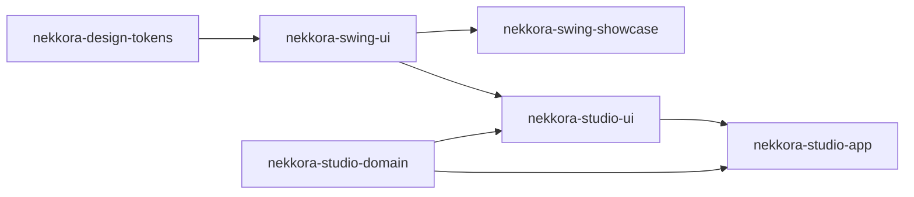

# STUDIO-001 — Arquitetura

## Módulos

```text
Nekkora-Studio/
├── nekkora-design-tokens    tokens e 4 temas (sem Swing)                      ← inalterado
├── nekkora-swing-ui         design system Swing (sem domínio)                 ← 3 correções genéricas de layout
├── nekkora-swing-showcase   vitrine + StudioDemo (demonstração)               ← inalterado
├── nekkora-studio-domain    modelo de automações (Java puro)                  ← novo
├── nekkora-studio-ui        componentes visuais do produto (usa o DS)         ← novo
└── nekkora-studio-app       aplicação executável (estado, casos de uso, tela) ← novo
```



As dependências só descem. Verificado por teste (S001-019):

| Regra | Teste |
|---|---|
| O domínio não importa `javax.swing`, `java.awt`, FlatLaf, tokens, design system, UI ou app; o pom só tem JUnit | `DomainLayerTest`, `StudioScopeTest.camadas` |
| O design system (tokens, swing-ui, showcase) não conhece `com.nekkora.studio` nem depende dos módulos do Studio | `StudioScopeTest.camadas` |
| `nekkora-studio-ui` não conhece a aplicação | `StudioUiTest.semDependenciaDaAplicacao`, `StudioScopeTest.camadas` |
| Nenhuma tela usa cor/fonte/borda/espaço/posição direta | `DesignLintTest` (showcase, studio-ui, studio-app) |

## Responsabilidades

| Módulo | Pacotes | Responsabilidade |
|---|---|---|
| domain | `domain` | Agregado `Automation → LogicalSession → AutomationStep`, `AutomationCatalog`, identidades, validação (`Texts`, `ValidationProblem`), sequência calculada (`StepPosition`) |
| | `domain.action` | `ActionType` (catálogo com metadados), `ActionParameters`, `ValueSource` (literal/variável/credencial), `OptionChoice` |
| | `domain.origin` | `StepOrigin` (MANUAL, RECORDED, IMPORTED, GENERATED) e `StepProvenance` |
| | `domain.element` | `ElementReference` e partes (localizadores, trajetória, contexto, obstáculos, chaves de correlação) — fronteira com o PageMap 0.2.0 |
| | `domain.privacy` | `DisplaySafety` — barreira de apresentação |
| | `domain.port` | `StepIntake` — porta de entrada de etapas (Recorder futuro) |
| studio-ui | `ui` | `AutomationNavigator`, `AutomationOverview`, `LogicalSessionView`, `PropertiesPresenter`, `ElementPresentation`, `StepPresentation`, `StudioText`, `ActionTypeStyle` |
| | `ui.form` | `StudioForm` e formulários (`NameDescriptionForm`, `StepForm`, `StepDetailsForm`), `FormSpec`, `StudioForms`, `StudioDialogs` |
| app | `app` | `StudioApplication` (main), `Studio` (composition root) |
| | `app.workspace` | `StudioState` (estado observável), `WorkspaceService` (casos de uso, implementa `StepIntake`), `Selection`, `StudioChange`, `StudioEvent`, `Notice`, `StudioOperation` |
| | `app.ui` | `StudioView` (composição sobre o `NekkoraWorkbench`), `StudioController` (intenções → casos de uso), `StudioActions`, `StudioPrompts` / `SwingStudioPrompts` |

## Inicialização

```text
StudioApplication.main(args)
  └─ EDT: Nekkora.install([tema])            design system (tema salvo ou --theme=...)
        NekkoraFrame("Nekkora Studio")       DO_NOTHING_ON_CLOSE → controller.requestExit()
        Studio.create(clock, SwingStudioPrompts, exit)
          AutomationCatalog(clock)           catálogo vazio (sem dados fictícios)
          StudioState(catalog)
          WorkspaceService(state)            casos de uso + StepIntake
          StudioController(service, prompts, exit)
          StudioView(state, controller)      Workbench: sidebar | navegação | abas | propriedades
```

Sem login, sem licença, sem rede: o Studio abre direto no ambiente local de trabalho.

## Fluxo de uma alteração (domínio → interface)

```text
Ctrl+E / botão "Nova etapa"
  → StudioController.newStep()                       abre FormSpec "Nova etapa" (StudioPrompts)
  → [confirmar] submit(values)
      → WorkspaceService.addManualStep(...)           (EDT)
          → Automation.appendStep(sessionId, draft)   valida ANTES de alterar; DomainValidationException se recusar
          → StudioState: markUnsaved, select(step)
          → fire(StudioEvent{CONTENT, CATALOG, UNSAVED_CHANGES}) e fire({SELECTION})
  ← problema de validação? volta ao formulário, mensagem no campo, diálogo continua aberto
StudioView.onEvent
  CONTENT          → AutomationOverview.refresh()      reconcilia: reaproveita LogicalSessionView, relê a sessão
  CATALOG          → AutomationNavigator.show(...)     resumo "3 sessões · 7 etapas"
  SELECTION        → overview.showSelection + PropertiesPresenter.showStep (sem disparar eventos de volta)
  UNSAVED_CHANGES  → barra de status "Alterações não salvas"
```

Fonte única de dados (P2): componentes guardam apenas referências ao domínio e releem a cada evento; nenhum painel
mantém lista própria de etapas. A numeração `01..n` é calculada por `Automation.sequence()`.

## EDT

`WorkspaceService` recusa chamadas fora da EDT (`IllegalStateException`). Diálogos são modais na EDT. Nenhuma
operação bloqueante existe nesta fase; quando o Recorder chegar (STUDIO-002), produtores em outras threads entregam
etapas por `StepIntake` via `SwingUtilities.invokeLater`.

## Execução

```bash
./mvnw verify                         # 162 testes (inclui escala 150% em JVM separada)
./studio.sh                           # Windows: studio.cmd — compila e abre o Studio
java -jar nekkora-studio-app/target/nekkora-studio.jar --theme=porcelain-light
java -Dflatlaf.uiScale=1.5 -jar nekkora-studio-app/target/nekkora-studio.jar
```

O Showcase continua independente (`./showcase.sh`, `--studio` abre a tela demonstrativa).
