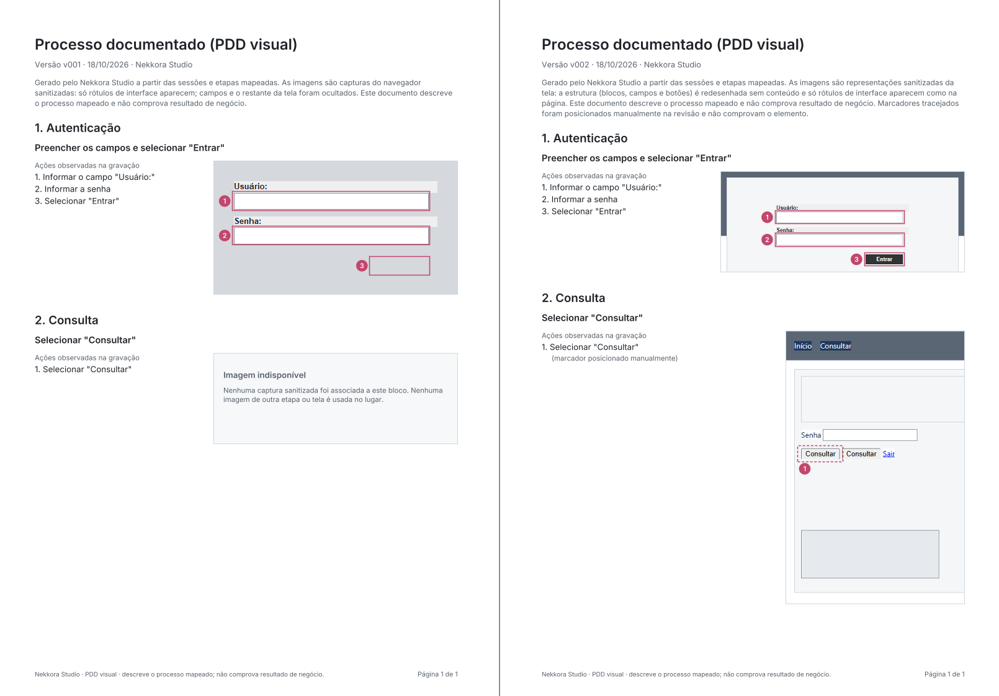

# STUDIO-012 · Adendo PDD-01 — relatório

PDD visual legível (`nekkora-visual/2`), captura manual assistida por bloco (Capturar novamente → revisar → recortar →
Aplicar/Cancelar) e marcadores manuais. Branches `feat/nekkora-studio-012-pdd01` na extensão e no Studio, a partir das
`main` com a STUDIO-012 integrada. **Sem merge automático**: extensão primeiro, depois o Studio.

Documentos deste adendo:

- `g0-diagnostico.md`: causas, desenho da v2, compatibilidade e achados laterais (A1–A3);
- `importacao-png.md`: estudo da importação de PNG local e o **bloqueio**;
- extensão, `docs/studio-012/pdd-01-visual-policy-v2.md`: plano visual, sanitizador, host e contrato;
- `evidence/`: homologação real (log, capturas da interface, PDFs antes/depois, rascunho, texto extraído).

## 1. Antes × depois

Mesma tela sintética (réplica da vistoria em `test-lab/pages/studio012/pdd-login.html`, dados fictícios), mesmo projeto,
no Studio real:

| | Antes (`nekkora-visual/1`, v001) | Depois (`nekkora-visual/2`, v002) |
|---|---|---|
| Imagem do login | 96,8% em `#D5D8DD` (ocultação) | estrutura redesenhada: faixa, logotipo como lugar, cartão, rodapé |
| Botão "Entrar" | retângulo vazio com o marcador 3 | rótulo real legível, marcador 3 no lugar |
| Campos | molduras vazias | molduras vazias (igual) |
| Página adversarial (Consulta) | recusada inteira pela v1 (`CARRIER_TOO_LARGE`) → "Imagem indisponível" | aceita: menu, tabela, iframe de outra origem, status e botão grande viram estrutura vazia; só rótulos aprovados |
| Cinza de ocultação na página 1 do PDF | 5,84% | 0,11% (só a suavização de bordas `#C9D1D9` no render) |
| Pixels-sentinela (texto sensível do laboratório) | 0 | 0 |

## 2. Política visual: o que mudou de v1 para v2

| | v1 | v2 |
|---|---|---|
| Fundo | tudo `#D5D8DD` | página `#FFFFFF`; superfícies com **tom** LIGHT/MID/DARK (classe de luminância, nunca a cor) e borda |
| Mídia, frames, controles | cinza | só o **lugar** (paleta fechada); conteúdo de frame nunca lido |
| Portadores (pixels reais) | `label`, `button`, `legend`, `summary`, `a[href]`, `[role]` | os mesmos **+** `input[type=submit\|button\|reset]` com `value` inteiro do vocabulário |
| Recusa de portador | — | imagem de fundo própria ou de ancestral, tocar campo/frame/mídia, alto ou largo demais, coberto |
| Verificação de pixels | fora dos portadores, qualquer uma das 3 cores | **repintura**: cada pixel fora dos portadores tem de ser exatamente a cor esperada naquele ponto |
| Barreiras | extensão, host, Studio na entrada, Studio ao exportar | as mesmas quatro, com a regra da v2 |

A v1 continua válida e inalterada: o Studio só pede a v2 a uma extensão ≥ 0.5.0, e lê, mostra e exporta rascunhos e
capturas v1 (fase A da homologação).

## 3. Rascunho: esquema e compatibilidade

- `nekkora-studio/pdd-visual` **1.0.0** continua sendo gravado byte a byte igual ao da STUDIO-010 enquanto nenhuma
  novidade é usada.
- **1.1.0** é usado quando aparece captura v2, recorte, marcador manual ou duas capturas com o mesmo PNG. A mudança é
  avisada na tela ("Imagem associada · rascunho 1.1.0").
- O que muda no 1.1.0:
  - cada captura tem `ref` própria (o sha-256 deixa de ser a chave: achado A2);
  - recorte `crop {x, y, width, height, reviewer}` em px do dispositivo;
  - marcadores com `provenance` AUTOMATIC/MANUAL e `reviewer` (DEVELOPER/TEST_AGENT, só no manual);
  - regiões v2 com `tone`.
- Leitura estrita das duas versões. Um 1.0.0 com conteúdo do 1.1.0 é recusado.
- A automação (`.nekkora`) não muda em nenhum caso: revisão da automação, StepIds e localizadores são conferidos na
  homologação.

## 4. Captura manual assistida, recorte e marcadores

- **Capturar novamente…** num bloco com imagem traz uma **candidata**, que fica só em memória e já passou pela 4ª
  barreira.
  - O bloco continua com a imagem anterior.
  - A prévia mostra o PDF com a candidata.
  - Enquanto há candidata, Exportar e Capturar ficam bloqueados (selo "Nova captura em revisão").
  - **Aplicar** substitui só aquele bloco.
  - **Cancelar**, falha, gesto em outra aba ou processo alterado descartam a candidata, e a anterior fica.
- **Selecionar área / Recorte automático**: por arrasto ou pelo teclado (setas movem, Shift+setas mudam o tamanho,
  Enter aplica, Esc sai).
  - O recorte é metadado: o PNG verificado não muda.
  - Há mínimo de tamanho, e o recorte tem de ficar dentro da imagem.
- **Posicionar marcador**: só para instrução **sem** marcador automático, por exemplo quando o resolvedor encontra um
  sósia (`AMBIGUOUS`).
  - O marcador fica tracejado no PDF, com a nota "marcador posicionado manualmente".
  - O texto de abertura diz que marcadores tracejados não comprovam o elemento.
  - Bloco alterado descarta a imagem do bloco e os marcadores manuais junto.
- Desfazer/Refazer cobrem aplicar, recorte e marcadores. A imagem anterior fica no disco enquanto o histórico a
  alcança. No fim do histórico (troca de automação, Studio encerrando) só ficam as imagens referenciadas.

## 5. Importação de PNG: BLOQUEADA

Não há nenhuma rota de importação no código. O motivo e o que seria preciso para liberar estão em `importacao-png.md`.
Em resumo: sem DOM não há regiões comprovadas, e uma máscara manual não prova ausência de dado sensível. A primeira
solução entregue é a captura manual assistida no Chrome.

## 6. Defeitos encontrados na homologação real (e corrigidos)

| Defeito | Origem | Correção |
|---|---|---|
| A janela do PDD punha o painel numa pilha vertical, que lhe dava a altura **preferida**. Com a imagem do bloco, o painel transbordava a janela: Aplicar/Cancelar ficavam abaixo da borda e as colunas não rolavam. | STUDIO-010 (só apareceu agora) | `SwingPddHost` com `BorderLayout` |
| Com as colunas rolando, a barra vertical aparecia e sumia (a altura da prévia depende da largura): laço infinito de layout, interface congelada. | revelado pela correção acima | barra vertical sempre visível nas duas colunas |
| Selo "Pronto para exportar" com uma candidata pendente (Exportar desabilitado). | PDD-01 | selo "Nova captura em revisão" |
| Depois de exportar e mudar a automação, "PDF desatualizado" cobria "Captura armada · pressione Alt+Shift+K". | STUDIO-010 | com captura armada, a instrução tem prioridade |
| O fim do histórico de desfazer não apagava as imagens que só ele alcançava. | PDD-01 (A1) | limpeza no fim do histórico e ao abrir rascunho legível |
| O jar do Studio não continha `nekkora-studio-semantics` (debug guiado quebrava no jar). | STUDIO-009 (A3) | escopo corrigido + `PackagingScopeTest` |

Também foram corrigidos dois testes da extensão:

- `Studio012PddVisualIT`: o controle positivo media outra janela;
- `Studio002BridgeIT`: fixava a versão "0.4".

## 7. Provas

| Suíte | Resultado |
|---|---|
| Extensão: Node | 186/186 |
| Extensão: Java (núcleo, host, contrato) | 301/301 |
| Extensão: Chrome for Testing headless (todas as classes, 8 grupos) | 282/282 |
| Extensão: Chrome com janela e gesto real | `Studio012PddVisualIT` 5/5 · `Studio010SafeCaptureIT` 12/12 |
| Studio: `./mvnw clean install` (Windows) | 624/624 |
| Studio: homologação real `Studio012Pdd01Homologation` | **87/87** (`evidence/PDD01-homologacao-log.txt`) |
| Studio: homologação com a interface em 150% | **5/5** (`evidence/PDD01-homologacao-150-log.txt`) |
| Teste de mutação (presenter, verificador, empacotamento) | 4/4 mutações detectadas |

A homologação real roda num Studio isolado com o Chrome for Testing e a extensão da branch, usando teclado e mouse do
sistema. O operador é **TEST_AGENT** (Claude). Gates:

- **A** — antes: extensão declarada 0.4.0, captura v1 que reproduz a vistoria; a v1 recusa a página adversarial;
  rascunho 1.0.0.
- **B1** — candidata v2: o bloco não muda, exportar fica bloqueado e Cancelar mantém a anterior.
- **B2** — gesto em outra aba: nada muda.
- **B3** — recorte:
  - recorte pequeno recusado;
  - recorte por arrasto (±1 px) e pelo teclado; Esc sai sem mudar nada;
  - Aplicar → rascunho 1.1.0, recorte com revisor e marcadores 1/2/3 automáticos;
  - Desfazer com o arquivo no disco e Refazer.
- **B4** — página adversarial: iframe `FRAMES_HIDDEN`, sósia `AMBIGUOUS` (nada inventado), marcador manual
  MANUAL+TEST_AGENT, automação intacta.
- **B5** — exportação:
  - v001 intacto;
  - **prévia = PDF exportado, pixel a pixel** (fora o rótulo de versão do cabeçalho);
  - texto, metadados, ordem;
  - 17 sentinelas fora do texto e 0 pixel-sentinela nas páginas.
- **B6** — mudanças de processo:
  - processo muda com candidata pendente → descartada;
  - etapa nova no bloco → imagem e marcador manual descartados;
  - o outro bloco fica intacto.
- **B7** — imagem adulterada no disco → exportação recusada, nenhum PDF novo.
- **B8** — interface: 4 temas, 1366×768 com Selecionar área/Aplicar/Cancelar/Exportar alcançáveis, Tab até Aplicar.
- **B9** — artefatos:
  - limpeza das imagens;
  - rascunho 1.1.0 reaberto;
  - nomes técnicos;
  - nenhum valor nem conteúdo do laboratório no rascunho, manifestos, logs do Studio e do host ou na automação;
  - 0 pixel-sentinela em todas as PNG.

Proteções da própria homologação: antes de cada clique, tecla ou captura de tela, a janela em primeiro plano **e** a
janela sob o ponto têm de ser do Studio de teste ou do Chrome de teste. Um vigia encerra os processos de teste se o
roteiro parar por 4 minutos. Numa rodada, o Microsoft 365 Copilot veio à frente e o roteiro parou sem clicar.

## 8. Limites residuais e decisões em aberto

- **Tom DARK (`#5B6675`)**: faixas escuras da página (topo, rodapé) continuam escuras na v2. Isso mantém a estrutura
  reconhecível, mas pesa contra o "fundo claro" quando o recorte as inclui. Clarear o tom mexe nas quatro barreiras e
  nos vetores, por isso fica para decisão da usuária. Com o recorte do cartão, a página 1 do PDF fica com 3,5% de
  pixels escuros, texto incluído.
- **Rótulos com fundo real**: um rótulo é um recorte da página, então o fundo real dele aparece em volta do texto (por
  exemplo `#EFEFEF` sobre o LIGHT `#F4F6F8`). A diferença é discreta, mas existe.
- **Trilha real**: não houve captura de sistema real. A recaptura no ambiente de homologação indicado fica para a
  usuária: abrir o PDD, "Capturar novamente…" no bloco do login, revisar, recortar, Aplicar, exportar. Eu audito só
  metadados.
- **Corrida rara em IT antigo**: `Studio010SafeCaptureIT.trocaDuranteAPreparacao` falhou uma vez numa execução conjunta
  das duas classes com janela. Não se repetiu em três execuções seguidas (sozinha e em conjunto). O caminho da v1 não
  foi alterado.
- **150%**: a interface do Studio em 150% foi homologada (escala da JVM). A escala do Windows estava em 100%. O zoom de
  150% no Chrome é coberto pelo `Studio012PddVisualIT` (PDD01-04).
- **Studio a 150% numa tela de 1920×1032**: a janela do Studio tem largura mínima de cerca de 1020 px lógicos e cobre o
  Chrome. Para gravar é preciso alternar as janelas, o que é limitação de espaço, não do PDD.
