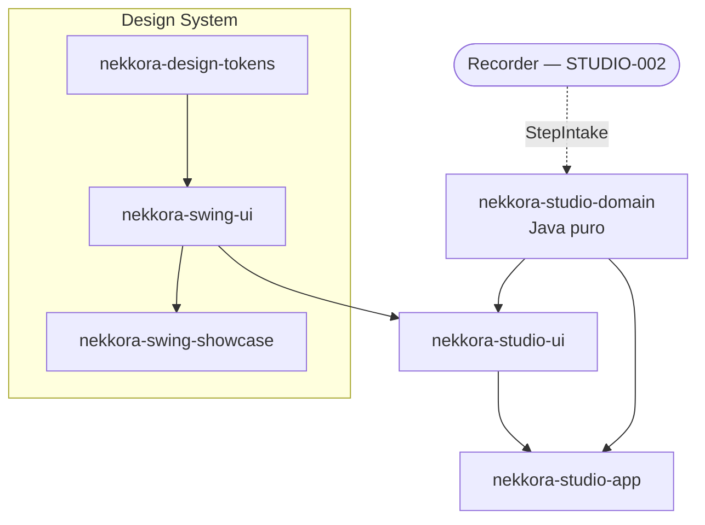
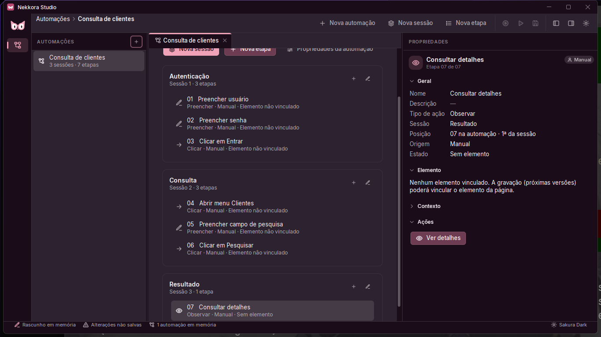
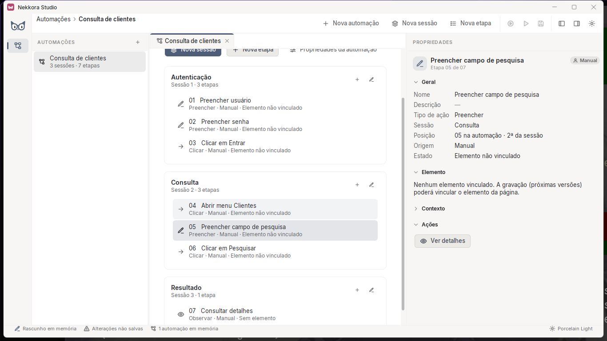

# NEKKORA-STUDIO-001 — Relatório final

**Branch:** `feat/nekkora-studio-001` · **Data:** 2026-10-14 · **Ambiente:** Windows 11 Pro, OpenJDK 21.0.12
(Microsoft), Maven Wrapper, tela 1920×1080 (área útil 1920×1032).

## 1. Objetivo

Estabelecer a fundação funcional do Nekkora Studio: uma aplicação desktop independente do Showcase, com domínio de
automações (Automação → Sessões lógicas → Etapas) real, criação manual de automações, sessões e etapas, painel de
propriedades, detalhes de etapa, identidade visual 100% do Design System e preparação para o Recorder — sem login,
licença, IA, execução, persistência ou exportação.

## 2. Baseline inicial

- `main` atualizada (`14c9063`), sem alterações pendentes além de `nekkora-swing-ui/src/test/resources/golden/windows/`
  (imagens golden do Windows geradas em 2026-09-26, nunca versionadas — mantidas assim).
- Módulos: `nekkora-design-tokens`, `nekkora-swing-ui`, `nekkora-swing-showcase`.
- `./mvnw verify`: **71 testes, 0 falhas** (24 tokens + 42 swing-ui + 5 showcase), BUILD SUCCESS.
- Contratos de referência lidos (somente leitura) em `Nekkora-Extension-Chrome@3c25a77`: `page-map.schema.json`
  (0.2.0), `capture-session.schema.json`, `privacy/privacy-vectors.json`.

## 3. Alterações realizadas

| Área | Alteração |
|---|---|
| Maven | 3 módulos novos no reactor; `dependencyManagement` para domínio e UI do Studio |
| `nekkora-studio-domain` (novo) | modelo de domínio, validação, `ActionType`, origem, `ElementReference`, `DisplaySafety`, porta `StepIntake` + 47 testes |
| `nekkora-studio-ui` (novo) | navegação, visão da automação, sessão, propriedades, formulários e diálogos + 12 testes |
| `nekkora-studio-app` (novo) | `StudioApplication` (jar executável `nekkora-studio.jar`), estado, casos de uso, controlador, composição + 29 testes + roteiro de evidências |
| `nekkora-swing-ui` | 3 correções genéricas (`NekkoraParagraph`, `NekkoraEmptyState`, `NekkoraTextLabel`) + `LayoutRegressionTest` (3 testes) |
| Raiz | `studio.cmd` / `studio.sh`; README atualizado |
| Documentação | `docs/studio-001/` (arquitetura, domínio, UI, decisões, plano de testes, limitações) |
| Showcase | inalterado (inclusive `StudioDemo` e seus testes) |

## 4. Estrutura final dos módulos

```text
Nekkora-Studio/
├── nekkora-design-tokens/      (inalterado)
├── nekkora-swing-ui/           (3 correções de layout + testes de regressão)
├── nekkora-swing-showcase/     (inalterado)
├── nekkora-studio-domain/      domain · domain.action · domain.origin · domain.element · domain.privacy · domain.port
├── nekkora-studio-ui/          ui · ui.form
├── nekkora-studio-app/         app · app.workspace · app.ui   →  target/nekkora-studio.jar
├── docs/studio-001/
├── reports/studio-001/evidence/
├── studio.cmd · studio.sh
└── pom.xml
```

## 5. Diagrama arquitetural



```text
Usuário → StudioView/StudioController → WorkspaceService (EDT) → Automation (valida e altera)
                                              │
                                              └─ StudioState.fire(StudioEvent) → StudioView atualiza só a parte afetada
```

Detalhes em `docs/studio-001/architecture.md`.

## 6. Modelo de domínio

`AutomationCatalog` → `Automation` (id, nome, descrição, `DRAFT`, sessões ordenadas, criação/atualização, versão do
modelo `1.0.0`, revisão) → `LogicalSession` (id, nome único, descrição, observações, etapas ordenadas) →
`AutomationStep` (id, nome, descrição, `ActionType`, `StepProvenance`, `ElementReference` opcional,
`ActionParameters`, `StepContext`, comentários, resultado observado). Nove tipos de ação com metadados; quatro origens
(`MANUAL` produzida; `RECORDED`/`IMPORTED`/`GENERATED` previstas). `ElementReference` alinhado ao PageMap 0.2.0, com
trajetória, âncoras de contexto sem profundidade fixa e chaves de correlação internas. Ver
`docs/studio-001/domain-model.md`.

## 7. Componentes reutilizados

`NekkoraFrame`, `NekkoraWorkbench`, `NekkoraSidebar`, `NekkoraToolbar`, `NekkoraToolbarButton`, `NekkoraBreadcrumb`,
`NekkoraNavigator`, `NekkoraList`, `NekkoraWorkArea`, `NekkoraTabs`, `NekkoraCard`, `NekkoraStack`, `NekkoraPanel`,
`NekkoraScrollPane`, `NekkoraEmptyState`, tipografia (`NekkoraHeading`, `NekkoraText`, `NekkoraCaption`,
`NekkoraParagraph`), `NekkoraIconMarker`, `NekkoraBadge`, `NekkoraStatusBadge`, `NekkoraButton`, `NekkoraIconButton`,
`NekkoraInspector`, `NekkoraPropertiesGroup`, `NekkoraKeyValueView`, `NekkoraSection`, `NekkoraDialog`,
`NekkoraConfirmationDialog`, `NekkoraFormField`, `NekkoraTextField`, `NekkoraTextArea`, `NekkoraComboBox`,
`NekkoraToast`, `NekkoraTooltips`, `NekkoraPopupMenu`, `NekkoraStatusBar`, `NekkoraActionRegistry`, `NekkoraKeys`,
`ThemeManager`, `Scale`. `NekkoraIdentifierLabel` não é usado nas telas funcionais.

## 8. Componentes novos

`AutomationNavigator`, `AutomationOverview`, `LogicalSessionView`, `PropertiesPresenter`, `ElementPresentation`,
`StepPresentation`, `StudioText`, `ActionTypeStyle`, `NameDescriptionForm`, `StepForm`, `StepDetailsForm`,
`StudioForm`, `FormSpec`, `StudioForms`, `StudioDialogs` — todos em `nekkora-studio-ui` (dependem do domínio, portanto
fora da biblioteca genérica). Nenhuma cor, fonte, borda ou posição própria (`DesignLintTest`).

## 9. Evidências visuais

Capturas reais da aplicação (`java.awt.Robot`), em `reports/studio-001/evidence/`:

| Evidência | 1366×768 (100%) | 1920×1032 (100%) | 1920×1032 (150%) |
|---|---|---|---|
| Inicialização com estado vazio | [01](studio-001/evidence/1366x768-01-inicial-vazio.png) | [01](studio-001/evidence/1920x1032-01-inicial-vazio.png) | [01](studio-001/evidence/escala150-1920x1032-01-inicial-vazio.png) |
| Diálogo nova automação | [02](studio-001/evidence/1366x768-02-dialogo-nova-automacao.png) | [02](studio-001/evidence/1920x1032-02-dialogo-nova-automacao.png) | [02](studio-001/evidence/escala150-1920x1032-02-dialogo-nova-automacao.png) |
| Automação criada | [03](studio-001/evidence/1366x768-03-automacao-criada.png) | [03](studio-001/evidence/1920x1032-03-automacao-criada.png) | [03](studio-001/evidence/escala150-1920x1032-03-automacao-criada.png) |
| Validação (nome obrigatório) | [04](studio-001/evidence/1366x768-04-validacao-nome-obrigatorio.png) | [04](studio-001/evidence/1920x1032-04-validacao-nome-obrigatorio.png) | [04](studio-001/evidence/escala150-1920x1032-04-validacao-nome-obrigatorio.png) |
| Múltiplas sessões | [05](studio-001/evidence/1366x768-05-multiplas-sessoes.png) | [05](studio-001/evidence/1920x1032-05-multiplas-sessoes.png) | [05](studio-001/evidence/escala150-1920x1032-05-multiplas-sessoes.png) |
| Diálogo nova etapa | [06](studio-001/evidence/1366x768-06-dialogo-nova-etapa.png) | [06](studio-001/evidence/1920x1032-06-dialogo-nova-etapa.png) | [06](studio-001/evidence/escala150-1920x1032-06-dialogo-nova-etapa.png) |
| Sessões com múltiplas etapas | [07](studio-001/evidence/1366x768-07-sessoes-com-etapas.png) | [07](studio-001/evidence/1920x1032-07-sessoes-com-etapas.png) | [07](studio-001/evidence/escala150-1920x1032-07-sessoes-com-etapas.png) |
| Propriedades de uma etapa | [08](studio-001/evidence/1366x768-08-propriedades-da-etapa.png) | [08](studio-001/evidence/1920x1032-08-propriedades-da-etapa.png) | [08](studio-001/evidence/escala150-1920x1032-08-propriedades-da-etapa.png) |
| Diálogo de detalhes | [09](studio-001/evidence/1366x768-09-dialogo-detalhes-da-etapa.png) | [09](studio-001/evidence/1920x1032-09-dialogo-detalhes-da-etapa.png) | [09](studio-001/evidence/escala150-1920x1032-09-dialogo-detalhes-da-etapa.png) |
| Aviso ao fechar | [11](studio-001/evidence/1366x768-11-aviso-ao-fechar.png) | [11](studio-001/evidence/1920x1032-11-aviso-ao-fechar.png) | [11](studio-001/evidence/escala150-1920x1032-11-aviso-ao-fechar.png) |

Temas (1366×768, mesmo estado): [Sakura Dark](studio-001/evidence/1366x768-10-tema-sakura-dark.png) ·
[Midnight Dark](studio-001/evidence/1366x768-10-tema-midnight-dark.png) ·
[Porcelain Light](studio-001/evidence/1366x768-10-tema-porcelain-light.png) ·
[Sage Light](studio-001/evidence/1366x768-10-tema-sage-light.png).





## 10. Testes executados

- `./mvnw clean verify` (todos os módulos, incluindo a execução `scale-150` em JVM separada).
- Roteiro em janela real `StudioEvidence` três vezes: 1366×768 com os quatro temas (`--full`), 1920×1032, e
  1920×1032 com `-Dflatlaf.uiScale=1.5`. Teclado e mouse reais: Ctrl+N, Ctrl+Shift+N, Ctrl+E, Tab, Shift+Tab, Enter,
  Esc, seta para baixo, clique na lista.
- Matriz completa S001-001 a S001-022: `docs/studio-001/test-plan.md`.

## 11. Resultados

| Módulo | Testes | Falhas | Ignorados |
|---|---|---|---|
| nekkora-design-tokens | 24 | 0 | 0 |
| nekkora-swing-ui | 45 | 0 | 0 |
| nekkora-swing-showcase | 5 | 0 | 0 |
| nekkora-studio-domain | 47 | 0 | 0 |
| nekkora-studio-ui | 12 | 0 | 0 |
| nekkora-studio-app | 29 | 0 | 0 |
| **Total** | **162** | **0** | **0** |

`BUILD SUCCESS` em 25,9 s. Janela real: 20 + 16 + 16 verificações, **0 falhas** (registros `*-log.txt`).

Critérios de aceite:

| CA | Situação | Evidência |
|---|---|---|
| 001 aplicação independente do Showcase | atendido | `StudioApplication`, `nekkora-studio.jar`, `studio.cmd/sh` |
| 002 Design System reutilizado | atendido | seção 7; `DesignLintTest` |
| 003 responsabilidades separadas | atendido | S001-019 |
| 004 abre sem login/licença | atendido | S001-001 |
| 005 criar automação | atendido | S001-003 |
| 006 sessões criadas e organizadas no domínio | atendido | S001-006/007 |
| 007 etapas manuais | atendido | S001-008 |
| 008 sequência preservada | atendido | S001-009 |
| 009 interface reflete o domínio | atendido | `StudioUiTest.visaoReconcilia`, S001-011 |
| 010 propriedades seguem a seleção | atendido | S001-011 |
| 011 detalhes da etapa | atendido | S001-012 |
| 012 sem identificadores internos | atendido | S001-013 |
| 013 sem ações simuladas | atendido | S001-020 |
| 014 quatro temas | atendido | S001-015/016 |
| 015 regras visuais do DS | atendido | `DesignLintTest` ×3 |
| 016 testes existentes aprovados | atendido | 71/71 (+3 novos no DS) |
| 017 novos testes aprovados | atendido | 88/88 nos módulos do Studio + 3/3 de regressão no DS |
| 018 limitações documentadas | atendido | `known-limitations.md` |
| 019 preparado para `RECORDED` | atendido | `StepIntake`, `etapaGravadaPelaPorta`, `PageMapContractTest` |
| 020 nada prematuro | atendido | `StudioScopeTest.semFuncionalidadesFicticias` |

## 12. Regressões

Nenhum teste anterior foi removido, alterado ou afrouxado. Os 71 testes do baseline continuam aprovados, incluindo
os golden screenshots do Windows (comparados com as imagens pré-existentes, que não foram regeneradas). O Showcase e
o `StudioDemo` não foram modificados.

## 13. Problemas encontrados

| Problema | Como foi encontrado | Tratamento |
|---|---|---|
| EDT em ciclo infinito: `NekkoraParagraph` num grupo recolhido do Inspector revalidava para sempre (Studio congelava) | roteiro real travou; thread dump (`jstack`) | correção no DS + `LayoutRegressionTest.paragrafoEmLarguraZero` |
| `NekkoraEmptyState` em painel estreito: ícone colapsado e texto cortado (navegação e área central em 1366×768) | captura 1366×768 | descrição limitada à largura disponível + ícone com tamanho mínimo; teste de regressão |
| Última letra cortada em títulos Sora ("Nova etapc", "Elementc") | capturas; medição: 92px de layout × 96px desenhados | folga de 6% para a fonte de display em `NekkoraTextLabel`; teste de regressão |
| Sidebar de 232px deixava ~400px para a automação em 1366×768 | captura | sidebar recolhida (DS001-12) |
| Destaque de sessão por elevação deslocava o cartão | captura | selo "Selecionada" (DS001-13) |
| Tab dentro da área de descrição inseria tabulação (armadilha de teclado) | roteiro real | Tab/Shift+Tab movem o foco; Ctrl+Enter confirma |
| Escolher outra automação na navegação apagava a seleção lembrada dela | `StudioFlowTest.multiplasAutomacoes` | navegação ativa a automação mantendo a seleção |
| Fechar automação pelo estado não removia a aba | `StudioFlowTest.fecharEReabrir` | sincronização remove abas fechadas |

## 14. Limitações

Resumo (detalhes em `docs/studio-001/known-limitations.md`): somente memória (aviso ao fechar); sem excluir/mover/
reordenar; sem renomear automação pela tela; sem Recorder/Chrome; toolbar fora da ordem de Tab (padrão FlatLaf, com
atalhos); golden do Windows não versionado e golden Linux não verificável aqui; 150% real limitado a 1920×1032
físicos (1366×768 lógicos a 150% verificado headless); sem teste com leitor de tela real.

## 15. Decisões

DS001-01 a DS001-18 em `docs/studio-001/decisions.md` — destaques: agregado único com ordem explícita e numeração
calculada; identidades com `toString()` mascarado; `ElementReference` alinhado ao PageMap sem depender do código da
extensão; privacidade em duas camadas; estado observável + serviço confinado à EDT; diálogos descritos por `FormSpec`;
painel de propriedades somente leitura; ações futuras desabilitadas; três correções genéricas no DS com testes.

## 16. Pendências

- Revisão e merge do PR (não realizado, conforme a missão).
- Confirmar os golden screenshots no próximo build Linux.
- Decidir se `golden/windows/` deve ser versionado (fora do escopo desta missão).
- STUDIO-004: edição completa (excluir, mover, reordenar, comentários, parâmetros, renomear automação).
- STUDIO-006: persistência usando `ModelVersion` e as identidades (`value()`).

## 17. Preparação para a STUDIO-002

- **Porta pronta**: `StepIntake.appendStep(automationId, sessionId, StepDraft)` — implementada por `WorkspaceService`,
  exposta por `Studio.stepIntake()`. Entrega etapas sem tocar na interface e sem roubar a seleção do usuário; a tela se
  atualiza pelos eventos de estado.
- **Etapa gravada**: `StepDraft.builder()` com `StepProvenance.of(RECORDED, CorrelationKeys(RECORDING_ID, CAPTURE_ID,
  TARGET_ID, NODE_ID...))`, `ElementReference`, `ActionParameters` (valor/opção) e `StepContext`.
- **Contrato**: enums do `ElementReference` verificados contra o PageMap 0.2.0; fixture sanitizado de "select em
  iframe"; protótipo do adaptador em `PageMapContractTest.toReference` — base para o adaptador de produção.
- **Privacidade**: o Recorder deve continuar entregando dados sob `nekkora-privacy/1`; campos sensíveis com
  `CredentialReference`/`VariableReference`.
- **Threads**: produtores fora da EDT devem chamar `StepIntake` via `SwingUtilities.invokeLater`.
