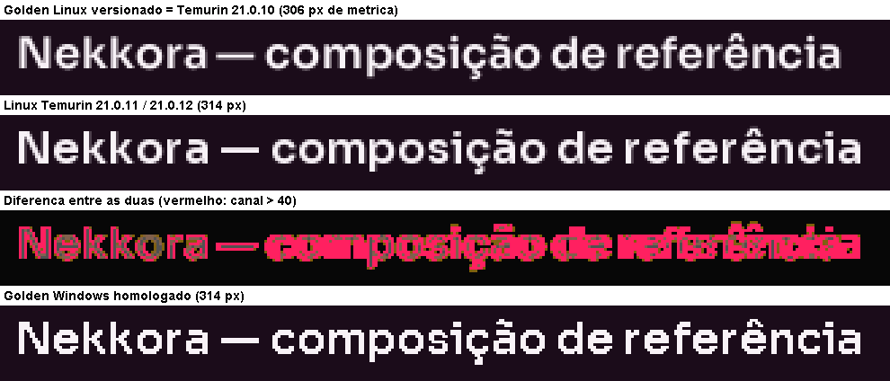

# STUDIO-001: validação visual complementar (golden screenshots Linux e Windows)

Data: 2026-10-14. Branch `chore/studio-001-golden-baselines`, criada a partir da `main` em `81ffa99` (merge do PR #1).
Esta entrega fecha as observações 1 e 2 da revisão da STUDIO-001. Ela não altera nenhum código de produção nem
de teste.

> **Situação final (após a revisão do PR #2):**
>
> - Aprovada a opção 1. Os 4 golden Linux foram regravados no ambiente de referência fixado por digest (Temurin
>   21.0.12.1+1, `linux/amd64`, `sha256:442a743d…061d`).
> - Os golden Windows ficaram inalterados.
> - Linux no ambiente fixado: **162/162, 0 ignorados**. Windows: **162/162**.
>
> Detalhes na seção 4. As seções 1 a 3 registram a investigação feita com o golden anterior (JDK 21.0.10).

## Resumo

| Pergunta | Resposta |
|---|---|
| Os golden Linux existentes passam sem modificações? | **Não** com o JDK 21 atual (Temurin 21.0.11 e 21.0.12): diferença de 0,47–0,49% contra o limite de 0,4%. **Sim** com Temurin 21.0.4 a 21.0.10: a renderização é idêntica byte a byte ao golden. |
| A STUDIO-001 causou a diferença? | **Não.** Com o mesmo JDK, as renderizações da `main` e do commit anterior à missão (`14c9063`) são idênticas byte a byte. |
| Qual é a causa? | Uma mudança de **métrica de glifos do JDK a partir do 21.0.11** no Linux. O título em Sora passou de 306 px para 314 px de largura, exatamente o valor do Windows. Não depende do FreeType nem da distribuição. |
| As correções de tipografia e layout funcionam no Linux? | **Sim.** `LayoutRegressionTest` passa nos dois JDKs. Medição da tinta desenhada: 44 títulos em Sora, nenhum cortado com a folga de 6% (sem ela, 4 ou 5 seriam cortados). |
| O visual é consistente com o Windows? | **Sim**, e ficou mais próximo com o JDK novo. A geometria é a mesma; as diferenças estão só nas bordas suavizadas do texto. Windows × Linux: 0,59% de pixels com o JDK 21.0.12 e 0,90% com o 21.0.10. |
| O golden Windows foi preservado? | **Sim.** As 4 imagens originais (2026-09-26) foram versionadas sem regeneração. A renderização atual no Windows é idêntica a elas pixel a pixel. |
| Os golden Linux foram regenerados? | Não durante a investigação, conforme a instrução. **Depois da aprovação da revisão, sim**: Temurin 21.0.12 fixado por digest (seção 4). |
| `./mvnw clean verify` | Windows: **162 testes, 0 falhas, 0 ignorados**. Linux no ambiente fixado, após a atualização: **162, 0 falhas, 0 ignorados**. |

## 1. Golden screenshots no Linux (Docker)

### Ambiente

- Docker Desktop 29.7.2 (engine Linux). Imagens oficiais `eclipse-temurin` (JDK 21).
- Código: `git archive` do commit testado, extraído dentro do contêiner. O repositório local não foi montado para
  escrita, então nenhuma imagem `.actual.png` nem golden foi gravada nele.
- Testes em modo headless (`java.awt.headless=true`, como no `pom.xml`). As fontes Sora, Inter e JetBrains Mono vêm
  do próprio Design System (recursos do jar). As fontes do sistema não entram na composição golden.

### Resultado por ambiente (`GoldenScreenshotTest`, código da `main`)

| Imagem | JDK | Sistema / FreeType | Resultado |
|---|---|---|---|
| `eclipse-temurin:21.0.4_7-jdk-jammy` | 21.0.4+7 | Ubuntu 22.04 / 2.11 | ✅ 4/4 |
| `eclipse-temurin:21.0.8_9-jdk-noble` | 21.0.8+9 | Ubuntu 24.04 / 2.13 | ✅ 4/4 |
| `eclipse-temurin:21.0.9_10-jdk-noble` | 21.0.9+10 | Ubuntu 24.04 | ✅ 4/4 |
| `eclipse-temurin:21.0.10_7-jdk-noble` | 21.0.10+7 | Ubuntu 24.04 | ✅ 4/4 (render idêntico byte a byte ao golden) |
| `eclipse-temurin:21.0.11_10-jdk-noble` | 21.0.11+10 | Ubuntu 24.04 | ❌ 0,47–0,49% |
| `eclipse-temurin:21-jdk-jammy` | 21.0.12.1+1 | Ubuntu 22.04 / 2.11 | ❌ 0,47–0,49% |
| `eclipse-temurin:21-jdk-noble` | 21.0.12.1+1 | Ubuntu 24.04 / 2.13 | ❌ 0,47–0,49% |
| `eclipse-temurin:21-jdk` | 21.0.12.1+1 | Ubuntu 26.04 / 2.14 | ❌ 0,47–0,49% |
| `eclipse-temurin:21-jdk-alpine` | 21.0.12.1+1 | Alpine | ❌ 0,47–0,49% |

Falhas com o JDK 21.0.12 (iguais em todas as distribuições): `sakura-dark` 0,49%, `midnight-dark` 0,49%,
`porcelain-light` 0,47% e `sage-light` 0,48%.

### Diagnóstico

1. **Onde muda:** todos os pixels diferentes ficam no retângulo x 21–332, y 22–40, ou seja, o título H2 em Sora
   "Nekkora — composição de referência". Botões, campos, alerta, tabela e todo o texto em Inter são idênticos pixel a
   pixel.
2. **Não é a STUDIO-001:** com o JDK 21.0.12, as renderizações da `main` e do commit `14c9063` (anterior à missão) são
   idênticas byte a byte. As correções do Design System não alteram a composição golden no Linux.
3. **É o JDK:** a mesma diferença aparece em Ubuntu 22.04, 24.04, 26.04 e Alpine (FreeType 2.11 a 2.14). O que muda o
   resultado é só a versão do JDK. O Temurin 21.0.10 reproduz o golden com o mesmo SHA-256
   (`10504f55…51e0` em `sakura-dark`). O 21.0.11 e o 21.0.12 geram uma renderização nova, idêntica entre eles.
4. **O que mudou no JDK:** a métrica do título. `stringWidth` do H2 vai de 306 px (21.0.10) para 314 px (21.0.11 em
   diante). O valor novo é **igual ao do Windows** (314 px, Microsoft OpenJDK 21.0.12). Outros títulos em Sora mudam
   da mesma forma ("Nova etapa" em H1: 118 → 121 px; Windows: 121 px). Não identifiquei qual alteração do JDK provocou
   isso. O efeito foi medido, mas a nota de versão correspondente não foi confirmada.
5. **Fontes, DPI e ambiente:** fontes do sistema e DPI não interferem. A composição usa só as fontes embutidas, e a
   renderização é headless, sem escala de tela. O fator determinante é a versão do JDK.



Evidências em `reports/studio-001/golden-baselines/`:

- `titulo-linux-windows.png`: o título nas quatro situações (ampliação 3×);
- `diferenca-linux-golden-vs-jdk21012.png`: mapa de diferenças (vermelho = canal > 40, o critério do teste);
- `render-linux-jdk21012-sakura-dark.png`: renderização Linux completa com o JDK atual (não usada como golden);
- `diferenca-windows-vs-linux-jdk21012.png`: Windows × Linux.

### Correções de tipografia e layout no Linux

- `LayoutRegressionTest` (3 testes: parágrafo em largura zero, estado vazio estreito e folga de títulos de display)
  passa no Linux com o JDK 21.0.10 e com o 21.0.12.
- Medição da tinta desenhada (`tools/SoraProbe.java`): 44 títulos, nos 4 níveis em Sora (DISPLAY_L, DISPLAY_M, H1 e
  H2) com 11 textos do Studio e textos de estresse. O probe renderiza cada título fora da tela e compara a última
  coluna com tinta com a métrica de layout e com a largura preferida.

| Ambiente | Maior tinta/métrica | Cortados sem a folga | Cortados com a folga de 6% |
|---|---|---|---|
| Linux, Temurin 21.0.10 | 1,029 | 5 | **0** |
| Linux, Temurin 21.0.12 | 1,014 | 4 | **0** |
| Windows, Microsoft OpenJDK 21.0.12 | 1,014 | 1 | **0** |

Dados por título: `sora-*.csv`. Limite desta medição: ela é headless. Na janela real do Windows, a STUDIO-001 mediu
até ~4% (dicas de renderização do desktop). Não há área de trabalho Linux disponível para medir a janela real; a folga
de 6% cobre com sobra os 1,4–2,9% medidos aqui.

### Suíte completa no Linux

`./mvnw clean verify -Dmaven.test.failure.ignore=true`, para ver todos os módulos:

| JDK (contêiner) | design-tokens | swing-ui | showcase | studio-domain | studio-ui | studio-app | Resultado |
|---|---|---|---|---|---|---|---|
| Temurin 21.0.10 (Ubuntu 24.04) | 24 ✅ | 45 ✅ | 5 ✅ | 47 ✅ (1 ignorado) | 12 ✅ | 28 + 1 ✅ | **162, 0 falhas** |
| Temurin 21.0.12 (Ubuntu 26.04) | 24 ✅ | 45, **4 falhas (golden)** | 5 ✅ | 47 ✅ (1 ignorado) | 12 ✅ | 28 + 1 ✅ | 158 aprovados, 4 falhas golden |

O teste ignorado é `PageMapContractTest.fixtureNaoDivergiuDoContrato` (CA-019), que exige o repositório `Nekkora-Extension-Chrome` ao lado
do Studio (ausente no contêiner). No Windows ele roda e passa.

## 2. Golden screenshots do Windows

- Imagens: `nekkora-swing-ui/src/test/resources/golden/windows/{sakura-dark,midnight-dark,porcelain-light,sage-light}.png`.
- Origem: gravadas em 2026-09-26 23:45 (-03:00), na primeira execução Windows após o commit do Design System V1
  (`14c9063`, 2026-09-27 02:21 UTC). Ficaram fora do Git até agora e foram o baseline de comparação da STUDIO-001.
- Nenhum arquivo foi regenerado. O teste só grava quando a imagem não existe ou quando se passa
  `-Dnekkora.golden.update=true`, e as datas de modificação continuam as de 2026-09-26. SHA-256 antes e depois do
  `clean verify`:

| Arquivo | SHA-256 |
|---|---|
| `midnight-dark.png` | `84a8ccc2d5cef6f96aa072a4b698376b1a845ebe659a8b2faf9ec18a83f407d1` |
| `porcelain-light.png` | `ad5144efbb01c062c6d0b19f5268967d674057ab7b58ea676b29588736224ae6` |
| `sage-light.png` | `9d900f8aeca9888bc5d17d6b15fc35d897c755434f658e9ec60cef11c1083eb9` |
| `sakura-dark.png` | `b107c5a3bb5fd771f443524a0bcd4edf288704e3e2842e66e281bf7372345cf3` |

- Renderização atual no Windows (Microsoft OpenJDK 21.0.12+8, headless) contra o baseline: **0 pixels diferentes**
  nos 4 temas.
- `.gitignore` passa a ignorar `*.actual.png`, as renderizações gravadas ao lado do golden quando o teste falha.

## 3. Homologação no Windows

`./mvnw clean verify` em Windows 11, Microsoft OpenJDK 21.0.12+8, Maven Wrapper 3.9.11:

| Módulo | Testes | Falhas | Ignorados |
|---|---|---|---|
| nekkora-design-tokens | 24 | 0 | 0 |
| nekkora-swing-ui (inclui 4 golden) | 45 | 0 | 0 |
| nekkora-swing-showcase | 5 | 0 | 0 |
| nekkora-studio-domain | 47 | 0 | 0 |
| nekkora-studio-ui | 12 | 0 | 0 |
| nekkora-studio-app (28 + `Scale150Test` em JVM própria) | 29 | 0 | 0 |
| **Total** | **162** | **0** | **0** |

São os mesmos 162 testes da STUDIO-001, todos aprovados, BUILD SUCCESS.

## Recomendação apresentada à revisão (histórico)

O golden Linux versionado corresponde ao JDK 21.0.10 ou anterior. Com qualquer JDK 21 atual, ele falha por causa do
próprio JDK, não do código. Opções:

1. **(Recomendada)** Fixar o ambiente de referência do golden Linux numa imagem com digest, por exemplo
   `eclipse-temurin:21-jdk` = 21.0.12.1+1, `sha256:f9bf7e9fe2f9bc4657537c1a7e20c768f0c3bafca41598263be4714783dd62eb`.
   Depois, regenerar os 4 golden Linux nesse ambiente, num commit próprio e aprovado. A renderização resultante é a
   de `render-linux-jdk21012-sakura-dark.png`, mais próxima do Windows.
2. Manter o golden atual e fixar o ambiente Linux em Temurin 21.0.10
   (`sha256:cfa5cae8f739b7b0113cd9410874718456b79a4f459e203aa0c5b6e7dcd1d7b2`). Funciona, mas prende os testes visuais
   a um JDK sem as correções de segurança mais recentes.

Nos dois casos, vale registrar a versão do JDK junto do golden. O baseline do Windows tem o mesmo risco: ele
corresponde ao Microsoft OpenJDK 21.0.12 e pode mudar numa atualização futura do JDK.

## 4. Atualização do baseline Linux (aprovada na revisão do PR #2)

Decisão: opção 1. O golden Linux passa a corresponder ao Temurin 21.0.12, e o ambiente de referência fica fixado
por digest. Não se mantém um JDK antigo só para preservar imagens.

### Ambiente de referência

| Item | Valor |
|---|---|
| Tag (só referência; a homologação não usa a tag móvel `21-jdk`) | `eclipse-temurin:21.0.12.1_1-jdk-resolute` |
| JDK | Temurin 21.0.12.1+1 (build 21.0.12.1+1-LTS) |
| Base | Ubuntu 26.04 (`ubuntu:26.04`) |
| Arquitetura | `linux/amd64` |
| Digest do manifesto `linux/amd64` (usado na execução) | `sha256:442a743d9272be15c9872915eab0f7a1b6bb45b7c16c613acf172e2d7483061d` |
| Digest do índice multiarquitetura | `sha256:f9bf7e9fe2f9bc4657537c1a7e20c768f0c3bafca41598263be4714783dd62eb` |
| Script | `tools/golden-linux.sh` (`golden`, `verify` ou `update`) |

O ambiente fixado vale só para a homologação visual. O projeto continua em Java 21, e qualquer JDK 21 serve para
desenvolver.

### O que mudou

- Só os 4 golden Linux: `sakura-dark`, `midnight-dark`, `porcelain-light` e `sage-light`. Foram regravados com
  `tools/golden-linux.sh update` sobre uma cópia do commit, num commit próprio.
- As imagens novas são idênticas byte a byte às renderizações analisadas na seção 1 (JDK 21.0.12).
- Contra o golden anterior, em todos os temas, os pixels diferentes ficam só no título (x 21–332, y 22–40).
- Tolerância (0,4%) e critério por canal (> 40) inalterados. Nenhum código de teste ou de produção mudou.

| Arquivo Linux | SHA-256 anterior (JDK 21.0.10) | SHA-256 atual (JDK 21.0.12) |
|---|---|---|
| `midnight-dark.png` | `044b51f0ee9aa6e81cbb3b0c23dcd857e5254bd99e57146ca7fd833515a021a8` | `768e4c49b87359bc824fd3299ef69452922dc18c423cef3e9ada83b04979ce54` |
| `porcelain-light.png` | `8645bd77dea1b8bdaaa9aacec1b580e27cb2d515ddd1bce87fea5d16b26b3b3a` | `15ff9c7ad82f7b586bca967cab5632ab93d16ed09754b420d72bbe3712a6a89e` |
| `sage-light.png` | `e0f962a22ad231e65918ae5e648555e8dce7ba4c0cf045c3b21fa345b4a59709` | `de81b6cc78adc7426251a1528ba331f7699c0d3f86e2247cf10cb43704b9127f` |
| `sakura-dark.png` | `10504f55d28a65b2fd947c4df3ee4fd7a2a99639153703af4e6d815808b851e0` | `8ab98d19265a0ef2b0cd990792ce70b0cdb31da573316595132f4a7c0c92d16c` |

Os golden Windows mantêm os hashes da seção 2, conferidos depois da atualização.

### Homologação após a atualização

| Verificação | Resultado |
|---|---|
| Golden Linux, os 4 temas (`tools/golden-linux.sh golden`) | ✅ 4/4 |
| Golden Windows, os 4 temas | ✅ 4/4, hashes inalterados |
| `LayoutRegressionTest` (Linux e Windows) | ✅ 3/3 |
| Suíte completa Linux no ambiente fixado (`tools/golden-linux.sh verify`) | ✅ **162 testes, 0 falhas, 0 ignorados** |
| Suíte completa Windows (`./mvnw clean verify`) | ✅ **162 testes, 0 falhas, 0 ignorados** |
| Mudanças de produção | Nenhuma |

- Contrato com a extensão: o `tools/golden-linux.sh` coloca uma cópia do `HEAD` do `Nekkora-Extension-Chrome`
  (`3c25a77`) ao lado do Studio dentro do contêiner, na mesma posição relativa do Windows.
- Com isso, `PageMapContractTest.fixtureNaoDivergiuDoContrato` (CA-019) roda e passa também no Linux, sem mudar o
  teste.

## Reprodução

O caminho recomendado é o ambiente de referência: `tools/golden-linux.sh golden | verify | update`, na raiz do
repositório. Os utilitários da investigação, descritos a seguir, comparam versões do JDK.


Os scripts e utilitários estão em `reports/studio-001/golden-baselines/tools/`. Eles esperam um diretório montado em
`/in` com `src.tar` (gerado por `git archive HEAD`) e, para o probe, `probe/SoraProbe.java`. Exemplo:

```sh
git archive --format=tar -o /tmp/nk/src.tar HEAD
docker run --rm -v /tmp/nk:/in:ro -v /tmp/nk/out:/out -v nk-studio-m2:/root/.m2 \
  eclipse-temurin:21.0.10_7-jdk-noble sh /in/run-golden.sh
```

- `run-golden.sh`: roda só o `GoldenScreenshotTest` e registra o JDK e as diferenças.
- `run-full.sh`: `clean verify` completo.
- `run-render.sh`: grava as renderizações na cópia descartável do contêiner, para comparação.
- `run-probe.sh` + `SoraProbe.java`: medição da tinta dos títulos em Sora.
- `GoldenDiff.java`: diferença com o mesmo critério do teste (canal > 40), retângulo e mapa.
- `Crop.java`: recortes ampliados.
- `RenderGolden.java`: renderiza a composição golden no Windows a partir das classes de teste.
